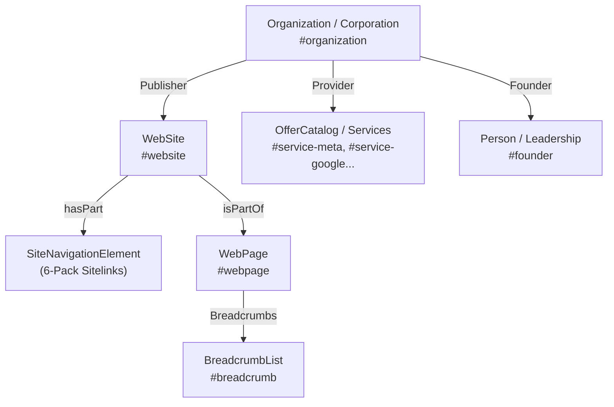

# 🌐 Blueprint & Strategi Penyesuaian SEO Adsvar (Entity-First & 6-Pack Sitelinks)

> **Standar Penerapan:** Mengacu pada metodologi arsitektur SEO enterprise yang diterapkan di **Artic Analytica**, **Arsalynk**, dan **Kaluna Technology**.  
> **Prinsip Utama:** Disesuaikan **100% tanpa mengubah desain visual apapun** (*Zero UI Impact*), bekerja murni pada lapisan struktural data Googlebot (`schema.org` JSON-LD, Metadata API Next.js, Semantic Navigation Hierarchy, Canonicalization, dan OpenGraph).

---

## 🎯 1. Target Tampilan SERP (Google Search Result)

Tujuan utama dari strategi ini adalah mendominasi halaman pertama saat pengguna mencari keyword brand seperti **"Adsvar"**, **"Adsvar Digital"**, **"Adsvar Agency"**, atau **"Adsvar Performance Marketing"** dengan tampilan **Expanded 6-Pack Sitelinks** dan **Knowledge Panel**:

```text
+---------------------------------------------------------------------------------------+
|  🌐 Adsvar Digital Agency  https://adsvar.id                                          |
|  Adsvar | Performance Ads Agency + Creative Engine                                     |
|  Ads that run. Content that sells. Meta, Google, TikTok Shop GMV Max, and Shopee       |
|  Ads, handled by one dedicated growth team with transparent monthly pricing.          |
|                                                                                       |
|  Services                               Pricing & Packages                            |
|  Full-funnel paid advertising on Meta.. Transparent monthly ad management packages... |
|                                                                                       |
|  Work & Case Studies                    About Adsvar                                  |
|  Explore verified client track records. Performance marketing agency combining media..|
|                                                                                       |
|  Free Ads Audit                         Client CRM & Portal                           |
|  Get an in-depth ad account audit...    Real-time client lead tracking, inquiry hub...|
+---------------------------------------------------------------------------------------+
|  KNOWLEDGE PANEL (Sisi Kanan Desktop / Bagian Atas Mobile)                            |
|  [Logo Adsvar]                                                                        |
|  Adsvar Digital Agency                                                                |
|  Performance Marketing Agency & Production Studio                                      |
|  Kontak: +62 823-2230-8719 | corporate@adsvar.id                                      |
|  Profil Media Sosial: LinkedIn | Instagram | YouTube | Twitter/X                      |
+---------------------------------------------------------------------------------------+
```

---

## 🏗️ 2. Arsitektur 6-Pack Sitelinks & Skema JSON-LD

Google menampilkan sitelink berdasarkan kombinasi **popularitas tautan internal**, **hierarki navigasi yang jelas**, dan **deklarasi skema eksplisit**:

### 2.1 6 Pilar Sitelinks Adsvar
Setiap entri navigasi dikonfigurasi dengan ringkasan padat (**110–140 karakter**) agar snippet dua baris di Google tidak terpotong (`...`):

1. **Services** (`/#layanan`)  
   *Deskripsi:* Full-funnel paid advertising on Meta, Google, TikTok, GMV Max, and Shopee with a built-in creative production engine.
2. **Pricing & Packages** (`/#paket`)  
   *Deskripsi:* Transparent monthly ad management packages from Starter to Scaling with zero hidden fees and no long-term lock-in.
3. **Work & Case Studies** (`/#portofolio`)  
   *Deskripsi:* Explore verified client track records, real revenue scaling, and high-converting creative case studies across top brands.
4. **About Adsvar** (`/#tentang`)  
   *Deskripsi:* Performance marketing agency combining ruthless analytical media buying with high-volume creative production in Jakarta.
5. **Free Ads Audit** (`/#konsultasi`)  
   *Deskripsi:* Get an in-depth ad account audit, waste spend analysis, and customized 90-day growth roadmap from our senior media buyers.
6. **Client CRM & Portal** (`/crm`)  
   *Deskripsi:* Real-time client lead tracking, inquiry management, and transparent campaign communication pipeline via secure SQLite CRM.

---

### 2.2 Hirarki Entity-First Schema Graph (`@id` Berantai)

Seluruh skema terhubung menggunakan `@id` URI permanen sehingga robot Google memahami hubungan relasional antar entitas secara utuh:



1. **`Organization` & `Corporation` (Entity Root - `#organization`):**
   - Brand entity (`Adsvar Digital Agency`), tahun pendirian (`2024`), logo resmi, email (`corporate@adsvar.id`), WhatsApp Business (+62 823-2230-8719), area cakupan (`ID`, `Global`), penawaran harga transparan, dan link media sosial terverifikasi (`sameAs`).
2. **`WebSite` (`#website`):**
   - Menghubungkan situs dengan entitas `Organization` sebagai penerbit resmi dan mendeklarasikan array `hasPart` yang memetakan 6 rute utama.
   - **Google Sitelinks SearchBox (Apple.com & Artic Analytica Standard):** Dilengkapi `potentialAction: SearchAction` mengarah ke query endpoint `adsvar.id/?q={search_term_string}` untuk memicu kotak pencarian langsung di SERP Google.
3. **`SiteNavigationElement` (Direct Sitelinks Trigger):**
   - 6 entri skema eksplisit untuk mengarahkan algoritma sitelinks Google (Services, Pricing & Packages, Work & Case Studies, About Adsvar, Free Ads Audit, Client CRM & Portal).
4. **Apple Web App & Mobile Standards:**
   - Meta tag `apple-mobile-web-app-capable`, `apple-mobile-web-app-status-bar-style: black-translucent`, `apple-mobile-web-app-title: Adsvar`, dan `format-detection: telephone=no, address=no, email=no`.
5. **High-Intent Keyword Matrix:**
   - Performance marketing agency Indonesia, Meta ads agency Indonesia, Google Ads agency Indonesia, TikTok Shop GMV Max agency, Shopee ads agency, jasa iklan Meta Ads, jasa GMV Max TikTok Shop, jasa Shopee Ads, creative production engine, direct response video agency, ROAS scaling Jakarta, e-commerce growth agency.
6. **`BreadcrumbList` (`#breadcrumb`):**
   - Dihasilkan secara hierarkis (Home -> Services -> Packages -> Work -> About -> Consultation).
7. **`OfferCatalog` (`#service-*`):**
   - Meta Ads (Facebook & Instagram), Google Ads (Search & Performance Max), TikTok Ads & Spark Ads, TikTok Shop GMV Max, dan Shopee Ads.

---

### 2.3 IndexNow Protocol (Bing, Yandex, Naver, Seznam)

Mengikuti modul `lib/seo/indexnow.ts` dari Artic Analytica, Adsvar dilengkapi protokol IndexNow dengan verification key file:
- File kunci publik: `/b76c10e5d4a63b7890a5463e71524f8b.txt`
- Endpoint IndexNow: `https://api.indexnow.org/indexnow`
- Memungkinkan indexing instan dalam hitungan menit untuk search engine berbasis Bing & partner.

---

## 🔍 3. Checklist Verifikasi & Langkah Pasca-Deploy (GSC)

1. **Verifikasi Google Search Console (GSC):**
   - Buka [Google Search Console](https://search.google.com/search-console).
   - Masukkan domain (misalnya `adsvar.id`) via verifikasi DNS TXT record atau set variabel `GOOGLE_SITE_VERIFICATION` di environment hosting (Vercel / VPS).
2. **Submit Sitemap:**
   - Masuk ke menu **Sitemaps** di GSC dan submit:
     ```text
     https://adsvar.id/sitemap.xml
     ```
3. **URL Inspection & Request Indexing:**
   - Jalankan *URL Inspection* pada homepage `/`, `/#layanan`, `/#paket`, `/#portofolio`, `/#tentang`, `/#konsultasi`, dan `/crm`.
   - Klik **Request Indexing**.
4. **Tes Validasi Rich Results Google:**
   - Uji URL di [Google Rich Results Test](https://search.google.com/test/rich-results) untuk memastikan tidak ada warning atau error pada skema `Organization`, `WebSite`, `BreadcrumbList`, dan `SiteNavigationElement`.
5. **Konsistensi Profil Bisnis:**
   - Pastikan nama dan nomor telepon (+62 823-2230-8719) terdaftar identik di LinkedIn Company Page, Google Business Profile, dan bio media sosial Adsvar.

