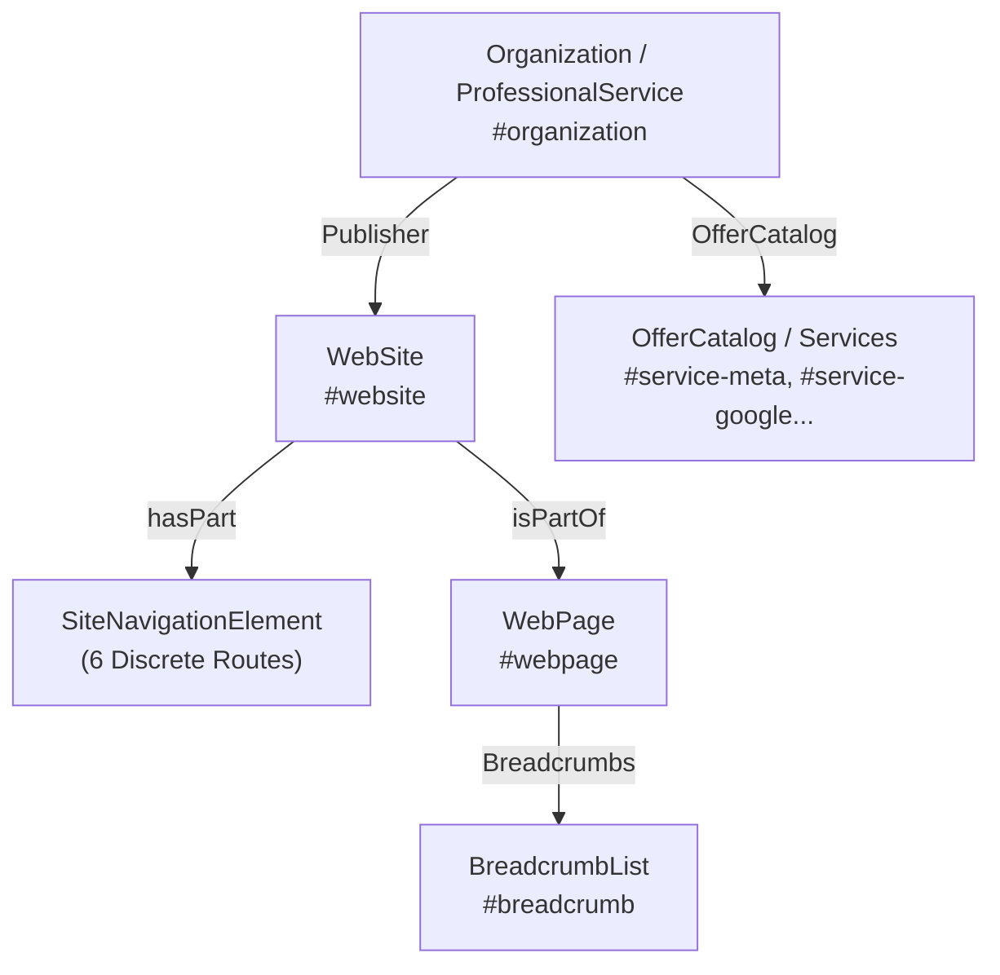

# 🌐 Blueprint & Arsitektur SEO Adsvar (Expanded 6-Pack Sitelinks & Paritas Artic/TheDraftRoom)

> **Standar Penerapan:** Mengacu pada metodologi arsitektur SEO enterprise 3-Tier yang diterapkan di **TheDraftRoom** (`thedraftroom-compro`) dan **Artic Analytica** (`compro-artic`).  
> **Prinsip Utama:** Disesuaikan **100% tanpa mengubah desain visual website** (*Zero UI Impact*), bekerja murni pada lapisan struktural data Googlebot (`schema.org` JSON-LD, Next.js Level-2 Canonical Routes, Semantic Microdata Navigation, 308 Alias Redirections, Canonicalization, dan IndexNow API).

---

## 🎯 1. Target Tampilan SERP Google (Expanded 6-Pack Sitelinks)

Tujuan utama dari arsitektur ini adalah mendominasi peringkat #1 dan menampilkan **Google Expanded 6-Pack Sitelinks** saat pengguna mencari kata kunci brand seperti **"Adsvar"**, **"Adsvar Digital"**, **"Adsvar Agency"**, atau **"Adsvar Performance Marketing"**:

```text
+---------------------------------------------------------------------------------------+
|  🌐 https://www.adsvar.id                                                             |
|  Adsvar | Performance Ads Agency + Creative Engine                                     |
|  Ads that run. Content that sells. Meta, Google, TikTok Shop GMV Max, and Shopee       |
|  Ads, handled by one dedicated growth team with transparent monthly pricing.          |
|                                                                                       |
|  Services                               Pricing & Packages                            |
|  Full-funnel paid advertising on Meta.. Transparent monthly ad management packages... |
|  https://www.adsvar.id/services         https://www.adsvar.id/packages                |
|                                                                                       |
|  Work & Case Studies                    About Adsvar                                  |
|  Explore verified client track records. Performance marketing agency combining media..|
|  https://www.adsvar.id/portfolio        https://www.adsvar.id/about                   |
|                                                                                       |
|  Free Ads Audit                         Contact Us                                    |
|  Get an in-depth ad account audit...    Get in touch with Adsvar performance team...  |
|  https://www.adsvar.id/consultation     https://www.adsvar.id/contact                 |
+---------------------------------------------------------------------------------------+
|  KNOWLEDGE PANEL (Sisi Kanan Desktop / Bagian Atas Mobile)                            |
|  [Logo Adsvar - Multi-Resolution Vector]                                              |
|  Adsvar (Adsvar Digital)                                                              |
|  Performance Marketing Agency + Creative Production Engine                            |
|  Kantor: Menara Rajawali Lt. 26, Mega Kuningan, Jakarta Selatan                       |
|  Kontak: +62 823-2230-8719 | corporate@adsvar.id                                      |
|  Profil Media Sosial: Instagram | LinkedIn | YouTube | Twitter/X                      |
+---------------------------------------------------------------------------------------+
```

---

## 🏗️ 2. Arsitektur 6-Pack Sitelinks Google

Google Sitelinks secara ketat memprioritaskan **rute HTTP kanonikal bersih (Level-2 discrete paths)** dibandingkan penanda hash fragment (`/#...`). Oleh karena itu, Adsvar mengimplementasikan sistem hybrid:

### 2.1 6 Rute Kanonikal Sitelinks
Setiap rute memiliki landing page mandiri dengan `SectionPageJsonLd`, metadata OpenGraph & Twitter lengkap, deskripsi 110–140 karakter (agar tidak terpotong `...` di SERP), serta merender section terkait tanpa mengubah estetika visual Adsvar:

1. **Services** (`/services`)  
   - *URL Kanonikal:* `https://www.adsvar.id/services`
   - *Deskripsi:* Full-funnel paid advertising on Meta, Google, TikTok, GMV Max, and Shopee with a built-in creative production engine.
   - *Schema Type:* `ItemPage` + `ItemList` Service Catalog
   - *Alias Redirect (308):* `/layanan` -> `/services`

2. **Pricing & Packages** (`/packages`)  
   - *URL Kanonikal:* `https://www.adsvar.id/packages`
   - *Deskripsi:* Transparent monthly ad management packages from Starter to Scaling with zero hidden fees and no long-term lock-in.
   - *Schema Type:* `ItemPage` + `Offer` Catalog
   - *Alias Redirects (308):* `/paket`, `/pricing`, `/harga` -> `/packages`

3. **Work & Case Studies** (`/portfolio`)  
   - *URL Kanonikal:* `https://www.adsvar.id/portfolio`
   - *Deskripsi:* Explore verified client track records, real revenue scaling, and high-converting creative case studies across top brands.
   - *Schema Type:* `CollectionPage` + `ItemList` CreativeWork
   - *Alias Redirects (308):* `/portofolio`, `/work`, `/case-studies` -> `/portfolio`

4. **About Adsvar** (`/about`)  
   - *URL Kanonikal:* `https://www.adsvar.id/about`
   - *Deskripsi:* Performance marketing agency combining ruthless analytical media buying with high-volume creative production in Jakarta.
   - *Schema Type:* `AboutPage`
   - *Alias Redirects (308):* `/tentang`, `/about-us` -> `/about`

5. **Free Ads Audit** (`/consultation`)  
   - *URL Kanonikal:* `https://www.adsvar.id/consultation`
   - *Deskripsi:* Get an in-depth ad account audit, waste spend analysis, and customized 90-day growth roadmap from our senior media buyers.
   - *Schema Type:* `ContactPage`
   - *Alias Redirects (308):* `/konsultasi`, `/audit`, `/free-audit` -> `/consultation`

6. **Contact Us** (`/contact`)  
   - *URL Kanonikal:* `https://www.adsvar.id/contact`
   - *Deskripsi:* Get in touch with Adsvar performance marketing team, request partnership proposals, or connect with our media buying leads.
   - *Schema Type:* `ContactPage`
   - *Alias Redirects (308):* `/kontak` -> `/contact`

---

## 🔍 3. Navigasi Semantik Googlebot (Zero UI Impact)

Di halaman utama (`app/page.tsx`), ditambahkan kontainer semantik HTML5 dengan class `sr-only`:
```tsx
<section aria-labelledby="adsvar-brand-overview" className="sr-only">
  <div>
    <h2 id="adsvar-brand-overview">Adsvar (Adsvar Digital) — Performance Ads Agency + Creative Engine</h2>
    <p>Adsvar runs your Meta, Google, TikTok, GMV Max, and Shopee ads...</p>
    <nav aria-label="Explore Adsvar Sitelinks">
      {SITE_NAVIGATION_ITEMS.map((item) => (
        <Link key={item.href} href={item.href} itemProp="url" itemScope itemType="https://schema.org/SiteNavigationElement">
          <span itemProp="name">{item.name}</span>
          <p itemProp="description">{item.description}</p>
        </Link>
      ))}
    </nav>
  </div>
</section>
```
- **Kelebihan:** 100% transparan bagi pengunjung website (tidak ada elemen baru yang terlihat atau merusak layout).
- **Kelebihan Bot:** Googlebot dan Bingbot langsung merayapi (crawl) 6 tautan internal resmi bersama atribut microdata `SiteNavigationElement`.

---

## 🌐 4. Entity-First Schema Graph (`@id` Linking)



1. **`Organization` & `ProfessionalService` (`#organization`):**
   - Brand entity `Adsvar`, phone `+62-823-2230-8719`, email `corporate@adsvar.id`, logo resmi `icon-512x512.png`, area cakupan global & Indonesia, social profiles.
2. **`WebSite` (`#website`):**
   - Terhubung dengan `hasPart` memetakan `/services`, `/packages`, `/portfolio`, `/about`, `/consultation`, `/contact`.
   - Mengandung `SearchAction` (Google Sitelinks SearchBox).
3. **`SectionPageJsonLd` (`app/components/seo/SectionPageJsonLd.tsx`):**
   - Secara otomatis menyuntikkan BreadcrumbList dan Page Schema spesifik (`AboutPage`, `ItemPage`, `CollectionPage`, `ContactPage`) pada setiap rute.

---

## ⚡ 5. IndexNow Protocol & Instant Crawler Dispatch

Endpoint otomatis tersedia di:
- **API Endpoint:** `/api/seo/indexnow`
- **GET Request:** Menginspeksi status dan daftar URL kanonikal yang siap disubmit.
- **POST Request:** Mengirimkan payload instan ke `https://api.indexnow.org/indexnow` untuk crawler Bing, Yandex, Naver, dan Seznam.
- **Verification Key:** `public/b76c10e5d4a63b7890a5463e71524f8b.txt`

---

## 🗺️ 6. Sitemap XML & Robots.txt

1. **Sitemap (`/sitemap.xml`):**
   - `https://www.adsvar.id/` (priority: 1.0, daily)
   - `https://www.adsvar.id/services` (priority: 0.9, weekly)
   - `https://www.adsvar.id/packages` (priority: 0.9, weekly)
   - `https://www.adsvar.id/portfolio` (priority: 0.9, weekly)
   - `https://www.adsvar.id/about` (priority: 0.8, monthly)
   - `https://www.adsvar.id/consultation` (priority: 0.9, weekly)
   - `https://www.adsvar.id/contact` (priority: 0.8, monthly)
2. **Robots (`/robots.txt`):**
   - Mengizinkan rayapan penuh pada seluruh rute publik dan menghubungkan ke `https://www.adsvar.id/sitemap.xml`.
